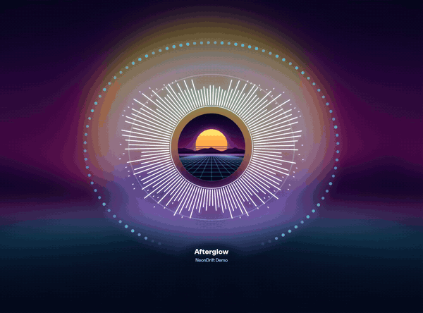
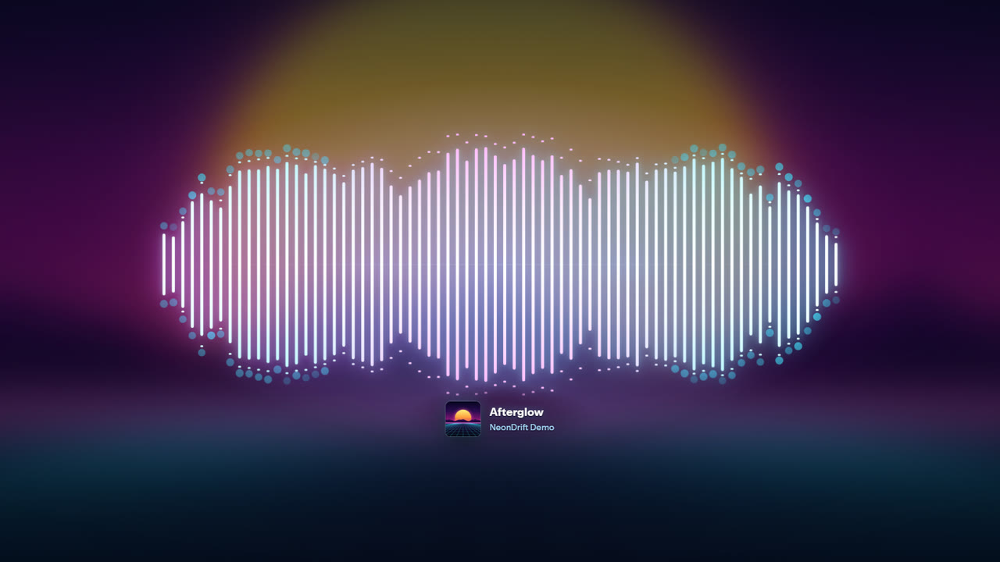
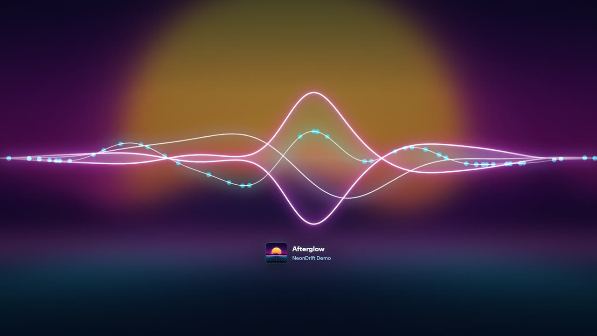
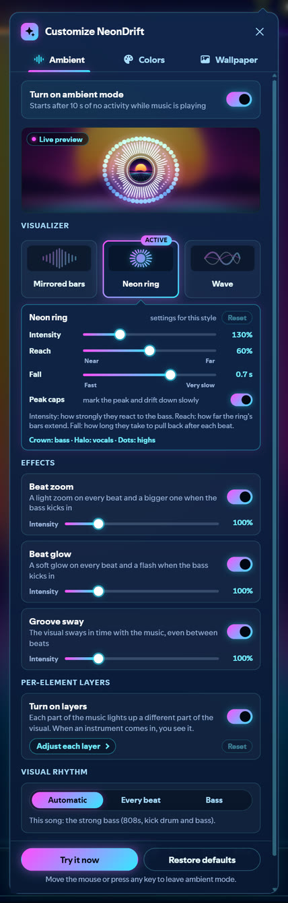
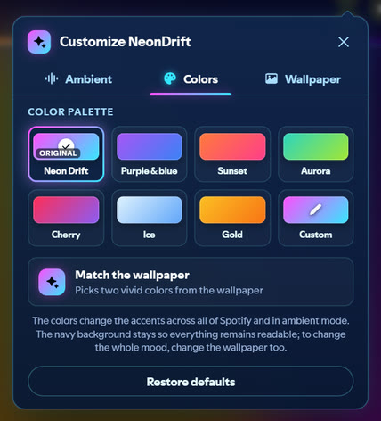
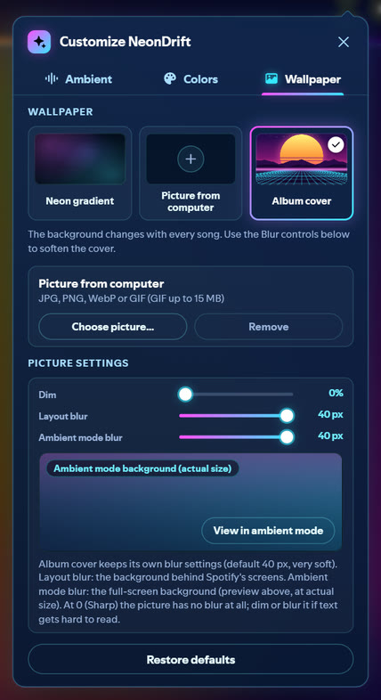
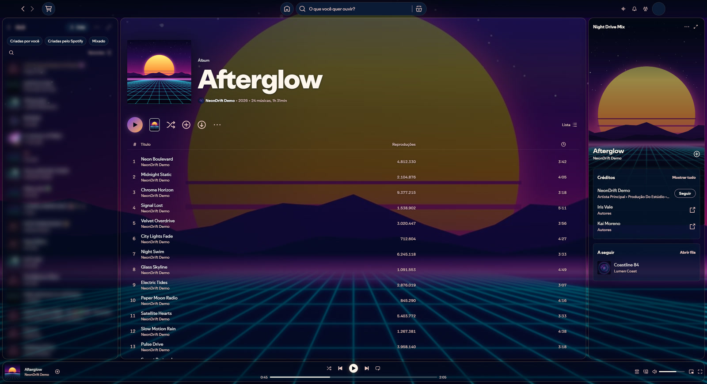
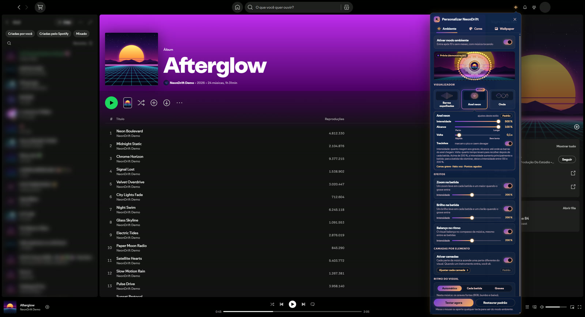

# NeonDrift for Spicetify

**Leia em português:** [README.pt-BR.md](https://github.com/irandsj/spicetify-neon/blob/main/README.pt-BR.md)

> **Em português, rapidinho:** o NeonDrift transforma o Spotify parado num visualizador neon que dança com a música.
> São duas peças: a extensão **NeonDrift Ambient** (modo ambiente, visualizador e painel "Personalizar NeonDrift")
> e o tema **NeonDrift** (o visual de vidro neon). A extensão funciona com qualquer tema; com o tema NeonDrift,
> as cores e o papel de parede mudam o Spotify inteiro. Tudo em português e em inglês.



When Spotify sits idle while music plays, **NeonDrift Ambient** fades the window into a full-screen neon
visualizer synced to the track: the album cover becomes the wallpaper, the bars, ring or waves move with the
kick, the bass, the voice and the hi-hats, and any mouse move or key brings Spotify back. The **NeonDrift** theme
gives the rest of Spotify the same neon glass look, in the colours you pick.

## What's inside

| | **NeonDrift Ambient** (extension) | **NeonDrift** (theme) |
|---|---|---|
| File | `extension/neondrift-ambient.js` | `theme/NeonDrift/user.css` + `color.ini` |
| Works with | any Spicetify theme, or none | best with the extension; also works alone |
| Gives you | ambient mode, the visualizer, the "Customize NeonDrift" panel, top-bar button and profile-menu entries | neon glass layout, two-colour accent system, wallpaper layer |

| Feature | Extension only | Theme only | Both |
|---|---|---|---|
| Ambient mode, panel, top-bar button, menu, languages | yes | no | yes |
| Accent colours in the overlay, panel and button | yes | – | yes |
| Accent colours across all of Spotify | no (the panel says so) | default Neon pair | yes |
| Layout wallpaper and "Layout blur" | no (hidden, with a note) | neon gradient | yes |
| Ambient wallpaper (album cover / your picture / neon gradient), Dim, ambient blur | yes | – | yes |

## Features

- **Ambient mode**: starts after 5, 10, 20, 30 or 60 s without touching Spotify, only while music plays.
  "Try it now" shows it at once. Menus, dialogs, typing, full screen, lyrics and the cinema views keep it away.
- **Three visualizers**: *Mirrored bars*, *Neon ring* and *Wave*, each with its own Intensity (up to 500 %),
  Reach, Fall (fast to very slow) and peak caps.
- **Synced to the music** through Spotify's own audio analysis: a kick detector fitted on recorded audio,
  look-ahead decays for dense passages, a "drums present?" gate, and a visual rhythm that follows every beat
  (trance, house) or the strong bass (trap, funk) automatically.
- **Per-element layers**: bass, vocals & melody, highs & hi-hats each light their own part of the visual;
  reactions for the bass entry (a shockwave), snares & claps and build-ups & breakdowns; colour that follows the harmony.
- **Effects**: beat zoom, beat glow and groove sway, each 0–500 %.
- **Soft mode** for tracks without an analysis (local files, podcasts, ads): everything keeps drifting slowly,
  with no invented beat.
- **Colours**: 7 presets, a custom pair (HSV sliders + hex) or *Match the wallpaper* (two vivid colours picked
  from the picture; with the album cover they follow every song).
- **Wallpaper**: the album cover (default), a picture from your computer (JPG, PNG, WebP or animated GIF,
  stored only on your computer) or the built-in neon gradient; Dim, Layout blur and Ambient mode blur.
- **Output latency** set automatically per device (wired / USB, Bluetooth, another Connect device).
- **Português (Brasil) and English**, following Spotify's language.
- Light on resources: nothing is drawn while ambient mode and the panel are closed.

## Requirements

- Spotify desktop with [Spicetify](https://spicetify.app) **2.x**.
- Tested on **Windows 11, Spotify 1.3.4.258, Spicetify 2.45.3**. Other Spotify versions: best effort
  (see [docs/COMPATIBILITY.md](https://github.com/irandsj/spicetify-neon/blob/main/docs/COMPATIBILITY.md)). macOS and Linux should work but are untested.
- Spicetify 3 does not load Spicetify 2 themes or extensions yet: stay on Spicetify 2 for now
  ([how to install Spicetify 2](https://github.com/irandsj/spicetify-neon/blob/main/docs/INSTALL.md#getting-spicetify-2)).

## Install

**Marketplace** (once published): open the Spicetify Marketplace, search **NeonDrift**, install the
**NeonDrift** theme (it brings the extension along) or only the **NeonDrift Ambient** extension.

**Manually**: see [docs/INSTALL.md](https://github.com/irandsj/spicetify-neon/blob/main/docs/INSTALL.md). In short:

```sh
# extension
copy extension/neondrift-ambient.js  ->  %appdata%\spicetify\Extensions\      (Linux / macOS: ~/.config/spicetify/Extensions/)
spicetify config extensions neondrift-ambient.js
# theme (optional)
copy theme/NeonDrift  ->  %appdata%\spicetify\Themes\NeonDrift
spicetify config current_theme NeonDrift color_scheme Neon
spicetify apply
```

## Use

- The **equalizer button** in the top bar (next to "What's New") opens **Customize NeonDrift**, with three tabs:
  **Ambient**, **Colors** and **Wallpaper**. The profile menu has **Ambient mode** (on / off) and
  **Customize NeonDrift** too.
- Leave Spotify alone while music plays and ambient mode starts by itself. Move the mouse or press any key to leave.
- Your settings are saved on this computer (Spotify's local storage). Nothing is sent anywhere.

## Screenshots

| | |
|---|---|
|  |  |

| | | |
|---|---|---|
|  |  |  |

| | |
|---|---|
|  |  |
| The NeonDrift theme | The extension without a theme |

All the pictures use a made-up demo album ("Afterglow" by "NeonDrift Demo") with artwork drawn for NeonDrift: no
real album covers, artist photos or names.

## FAQ

- **Is it safe? What does it send?** It only talks to Spotify itself: the audio analysis of the playing track
  (the same request Spicetify's `getAudioData` makes) and the cover pictures from Spotify's image server. No
  analytics, no remote code. The picture you choose stays in Spotify's local storage on your computer.
- **Some songs don't pulse.** Spotify has no analysis for some tracks (local files, podcasts, some new releases):
  those play in *soft mode*, with a small note in the corner. A failed request is retried by itself.
- **Will it slow Spotify down?** While ambient mode and the panel are closed it only checks, every 0.75 s,
  whether you are idle. The visualizer draws at most 60 frames a second, only while it is on screen.
- **Can I use another theme?** Yes. With another theme (or none) the extension works fully; its colours and
  wallpaper then change only the ambient mode, the panel and the button. The panel tells you so.
- **I can't see the top-bar button.** Use the profile menu (*Customize NeonDrift*). If neither shows up, a button
  appears in the player bar, and as a last resort **Ctrl+Alt+N** opens the panel.
- **The visual is a little late with Bluetooth headphones.** The extension uses a longer delay for Bluetooth and
  other devices automatically; very slow headsets may still lag a bit.
- **The language is wrong.** It follows Spotify's language (Settings > Language): Portuguese for Português,
  English for every other language.
- **A Spotify update broke part of the look.** Spotify renames its internal class names on updates. The theme is
  written to survive most of it, and the extension keeps working; see
  [docs/COMPATIBILITY.md](https://github.com/irandsj/spicetify-neon/blob/main/docs/COMPATIBILITY.md) and check for a theme update.
- **The Marketplace theme doesn't apply.** Marketplace themes only apply while Spicetify's theme is set to
  "marketplace" (`spicetify config current_theme marketplace`, then `spicetify apply`).
- **Spicetify 3?** Not yet: Spicetify 3 does not load Spicetify 2 themes / extensions. Keep Spicetify 2 for now; the
  install guide shows how to install it (the official installer picks the newest version unless you name one).

## Credits and license

Made by **Iran**. MIT License, see [LICENSE](https://github.com/irandsj/spicetify-neon/blob/main/LICENSE).
Not affiliated with Spotify or Spicetify. Spotify is a trademark of Spotify AB. Spicetify is not included.

Developers: the extension is built from `src/` with `node tools/build/build.mjs` (Node 18+, no dependencies);
`node tools/build/check.mjs` runs every release check. See [CHANGELOG.md](https://github.com/irandsj/spicetify-neon/blob/main/CHANGELOG.md).
