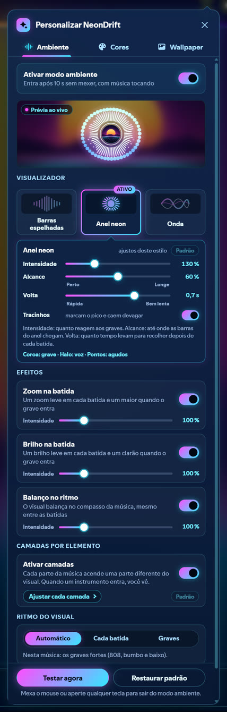
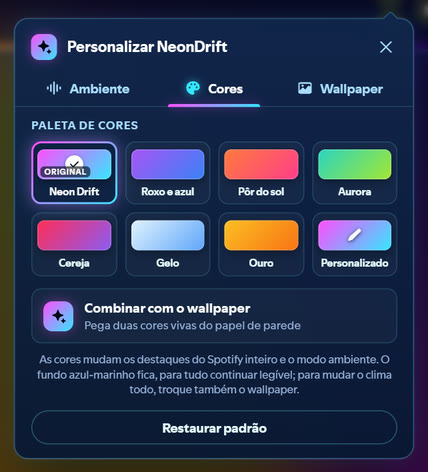
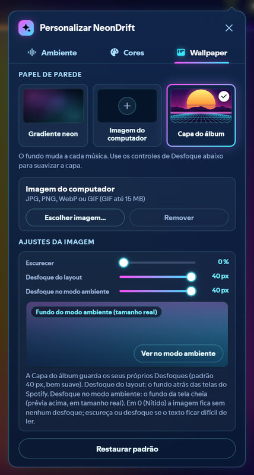

# NeonDrift para o Spicetify

**Read in English:** [README.md](README.md)


Quando o Spotify fica parado com música tocando, a extensão **NeonDrift Ambient** transforma a janela num
visualizador neon em tela cheia, no ritmo da música: a capa do álbum vira o papel de parede, as barras, o anel ou
as ondas mexem com o bumbo, o grave, a voz e o chimbal, e qualquer movimento do mouse ou tecla devolve o Spotify.
O tema **NeonDrift** dá ao resto do Spotify o mesmo visual de vidro neon, nas cores que você escolher.

## O que vem

| | **NeonDrift Ambient** (extensão) | **NeonDrift** (tema) |
|---|---|---|
| Arquivo | `extension/neondrift-ambient.js` | `theme/NeonDrift/user.css` + `color.ini` |
| Funciona com | qualquer tema do Spicetify, ou nenhum | melhor com a extensão; funciona sozinho também |
| O que faz | modo ambiente, visualizador, painel "Personalizar NeonDrift", botão na barra de cima e itens no menu do perfil | visual de vidro neon, sistema de duas cores, camada do papel de parede |

| Recurso | Só a extensão | Só o tema | Os dois |
|---|---|---|---|
| Modo ambiente, painel, botão, menu, idiomas | sim | não | sim |
| Cores no modo ambiente, no painel e no botão | sim | – | sim |
| Cores no Spotify inteiro | não (o painel avisa) | par Neon padrão | sim |
| Papel de parede do layout e "Desfoque do layout" | não (escondido, com aviso) | gradiente neon | sim |
| Fundo do modo ambiente (capa / sua imagem / gradiente neon), Escurecer, desfoque | sim | – | sim |

## Recursos

- **Modo ambiente**: entra depois de 5, 10, 20, 30 ou 60 s sem mexer no Spotify, só com música tocando.
  "Testar agora" mostra na hora. Menus, janelas, digitação, tela cheia, letras e o modo cinema não deixam entrar.
- **Três visualizadores**: *Barras espelhadas*, *Anel neon* e *Onda*, cada um com Intensidade (até 500 %),
  Alcance, Volta (de rápida a bem lenta) e tracinhos de pico.
- **No ritmo da música**, pela análise de áudio do próprio Spotify: detector de bumbo ajustado em áudio gravado,
  decaimento que olha à frente nos trechos rápidos, detecção de "tem bateria?" e o ritmo do visual escolhido
  sozinho (toda batida na eletrônica, os graves fortes no trap e no funk).
- **Camadas por elemento**: grave, voz e melodia, agudos e chimbal acendem cada um a sua parte do visual;
  reações quando o grave entra (onda de choque), caixa e palmas, subidas e calmarias; cor que acompanha a harmonia.
- **Efeitos**: zoom na batida, brilho na batida e balanço no ritmo, de 0 a 500 %.
- **Modo suave** para faixas sem análise (arquivos locais, podcasts, anúncios): tudo continua se mexendo devagar,
  sem batida inventada.
- **Cores**: 7 paletas prontas, um par personalizado (HSV + código hex) ou *Combinar com o wallpaper* (duas cores
  vivas tiradas da imagem; com a capa do álbum, elas mudam a cada música).
- **Papel de parede**: a capa do álbum (padrão), uma imagem do computador (JPG, PNG, WebP ou GIF animado, guardada
  só no seu computador) ou o gradiente neon; Escurecer, Desfoque do layout e Desfoque no modo ambiente.
- **Atraso do som** ajustado sozinho por aparelho (com fio / USB, Bluetooth, outro aparelho do Connect).
- **Português (Brasil) e inglês**, seguindo o idioma do Spotify.
- Leve: nada é desenhado enquanto o modo ambiente e o painel estão fechados.

## O que precisa

- Spotify para computador com o [Spicetify](https://spicetify.app) **2.x**.
- Testado no **Windows 11, Spotify 1.3.4.258, Spicetify 2.45.3**. Outras versões do Spotify: deve funcionar, sem
  garantia (veja [docs/COMPATIBILITY.md](docs/COMPATIBILITY.md)). macOS e Linux não foram testados.
- O Spicetify 3 ainda não carrega temas e extensões do Spicetify 2: continue no Spicetify 2 por enquanto
  ([como instalar o Spicetify 2](docs/INSTALL.pt-BR.md#como-ter-o-spicetify-2)).

## Instalar

**Marketplace** (depois de publicado): abra o Marketplace do Spicetify, procure **NeonDrift** e instale o tema
**NeonDrift** (ele já traz a extensão) ou só a extensão **NeonDrift Ambient**.

**Na mão**: veja [docs/INSTALL.pt-BR.md](docs/INSTALL.pt-BR.md). Resumo:

```sh
# extensão
copie extension/neondrift-ambient.js  ->  %appdata%\spicetify\Extensions\      (Linux / macOS: ~/.config/spicetify/Extensions/)
spicetify config extensions neondrift-ambient.js
# tema (opcional)
copie a pasta theme/NeonDrift  ->  %appdata%\spicetify\Themes\NeonDrift
spicetify config current_theme NeonDrift color_scheme Neon
spicetify apply
```

## Como usar

- O **botão de equalizador** na barra de cima (ao lado de "Novidades") abre o **Personalizar NeonDrift**, com três
  abas: **Ambiente**, **Cores** e **Wallpaper**. O menu do perfil também tem **Modo ambiente** (liga / desliga) e
  **Personalizar NeonDrift**.
- Deixe o Spotify quieto com música tocando e o modo ambiente entra sozinho. Mexa o mouse ou aperte uma tecla para sair.
- Os ajustes ficam guardados neste computador (no armazenamento local do Spotify). Nada é enviado para lugar nenhum.

## Imagens

| | |
|---|---|
|  |  |

| | | |
|---|---|---|
|  |  |  |

| | |
|---|---|
|  |  |
| O tema NeonDrift | A extensão sem tema |

Todas as imagens usam um álbum de demonstração inventado ("Afterglow", de "NeonDrift Demo"), com artes desenhadas
para o NeonDrift: nenhuma capa, foto ou nome de artista de verdade.

## Perguntas frequentes

- **É seguro? O que ele envia?** Ele só conversa com o próprio Spotify: a análise de áudio da música que está
  tocando (o mesmo pedido que o `getAudioData` do Spicetify faz) e as imagens das capas. Sem estatísticas, sem
  código baixado da internet. A imagem que você escolhe fica no armazenamento local do Spotify, no seu computador.
- **Algumas músicas não pulsam.** O Spotify não tem análise de algumas faixas (arquivos locais, podcasts, alguns
  lançamentos): elas tocam no *modo suave*, com um aviso pequeno no canto. Um pedido que falhou é repetido sozinho.
- **Deixa o Spotify pesado?** Com o modo ambiente e o painel fechados, ele só confere a cada 0,75 s se você está
  parado. O visualizador desenha no máximo 60 quadros por segundo, só enquanto aparece.
- **Dá para usar outro tema?** Dá. Com outro tema (ou nenhum) a extensão funciona inteira; as cores e o papel de
  parede mudam então só o modo ambiente, o painel e o botão. O painel avisa.
- **Não vejo o botão na barra de cima.** Use o menu do perfil (*Personalizar NeonDrift*). Se nenhum dos dois
  aparecer, surge um botão na barra do player e, em último caso, **Ctrl+Alt+N** abre o painel.
- **Com fone Bluetooth o visual atrasa um pouco.** A extensão já usa um atraso maior para Bluetooth e outros
  aparelhos; fones muito lentos ainda podem atrasar um pouquinho.
- **O idioma está errado.** Ele segue o idioma do Spotify (Configurações > Idioma): português para Português,
  inglês para os outros idiomas.
- **Uma atualização do Spotify estragou parte do visual.** O Spotify troca os nomes internos das classes nas
  atualizações. O tema foi escrito para aguentar a maior parte disso e a extensão continua funcionando; veja
  [docs/COMPATIBILITY.md](docs/COMPATIBILITY.md) e procure uma versão nova do tema.
- **O tema do Marketplace não aplica.** Temas do Marketplace só valem com o tema do Spicetify em "marketplace"
  (`spicetify config current_theme marketplace` e depois `spicetify apply`).
- **E o Spicetify 3?** Ainda não: ele não carrega temas e extensões do Spicetify 2. Continue no Spicetify 2; o guia
  de instalação mostra como instalar essa versão (o instalador oficial pega a mais nova se você não disser qual).

## Créditos e licença

Feito por **Iran**. Licença MIT, veja [LICENSE](LICENSE).
Sem ligação com o Spotify ou com o Spicetify. Spotify é marca registrada da Spotify AB. O Spicetify não vem incluído.
